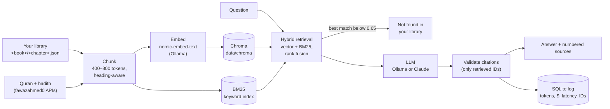

# Noor

**Ask your own Islamic library a question and get an answer with a source for every claim.**
Noor is a local-first retrieval-augmented generation (RAG) assistant over your books, the Quran and
Sahih al-Bukhari. It cites the book, chapter and page (or surah:ayah, or hadith number) behind each
sentence, and says *"Not found in your library"* instead of guessing.


*The demo runs on the self-written sample book in `samples/`. No real book text is in this repository.*

## Why this exists

It replaces a no-code (n8n) prototype that worked but couldn't be inspected. This version is built to
show how production AI should be run:

| | Where |
| --- | --- |
| Every answer grounded and cited; refusal when retrieval is weak | `rag/answer.py` |
| Cost, tokens and latency logged for every query | `rag/log.py`, [`reports/cost.md`](reports/cost.md) |
| An evaluation harness with go/no-go thresholds | `evals/`, [`reports/eval.md`](reports/eval.md) |
| A NIST AI RMF governance pack | [`governance/`](governance/) |
| Copyrighted text can never reach GitHub | `.gitignore`, `scripts/leak_check.py` |

## Results so far

**Evaluation** (46-question golden set: 37 answerable, 9 unanswerable including 3 Islamic-sounding traps):

| Metric | Threshold | qwen2.5:7b (local) |
| --- | --- | --- |
| Retrieval hit@6 | ≥ 85% | **86.5%** |
| Refusal on unanswerable | 100% | **100%** |
| Answer rate | ≥ 80% | **91.9%** |
| Groundedness (LLM judge) | ≥ 90% | 79.4% |
| Recommendation | | **NO-GO** (groundedness) |

Claude Haiku and Sonnet are wired in, but they haven't been evaluated yet, because no API key exists yet.
See [`reports/eval.md`](reports/eval.md) for caveats. The main one: retrieval was tuned on the same set.

**Cost** (prices read from Anthropic's pricing page on 2026-10-20; Claude projected from measured token counts):

| Model | $/query | 10,000 queries / month |
| --- | --- | --- |
| qwen2.5:7b on an RTX 2070 | $0 (≈ 9 s p50) | $0 |
| Claude Haiku 5.5 | ≈ $0.00033 | ≈ $3.28 |
| Claude Sonnet 5.5 | ≈ $0.0066 | ≈ $65.56 |

The answer cache served 20 of 20 repeat questions in about 3 ms instead of 9 s, for $0. The prompt cache
saves about 15% of Claude input cost while it's warm. Details are in [`reports/cost.md`](reports/cost.md).

## How it works



## Quick start (about 10 minutes)

You need **Python 3.11+**, **[Ollama](https://ollama.com)** and, for the web UI, **Node 20+**.

```bash
git clone https://github.com/NabilPervez/noor && cd noor
python -m venv .venv
.venv/Scripts/activate          # Windows (Git Bash). macOS/Linux: source .venv/bin/activate
pip install -e ".[dev]"
python scripts/install_hooks.py
ollama pull nomic-embed-text    # 274 MB
ollama pull llama3.2:3b         # 2 GB; quick to download
cp .env.example .env            # then set NOOR_MODEL=ollama:llama3.2:3b in .env
```

Measured on a fresh clone: clone, install, ingest and a first cited answer took **2.5 minutes**, plus
model downloads of about 2.3 GB. For better answers, `ollama pull qwen2.5:7b` (4.7 GB), which is the
`.env.example` default and the model the evals ran on.

Try it on the included sample book:

```bash
noor ingest samples/library
noor ask "What are the three kinds of patience?"
```

Then the web UI (two terminals):

```bash
uvicorn api.main:app --host 127.0.0.1 --port 8000
npm --prefix web install && npm --prefix web run dev     # open http://127.0.0.1:5317
```

## Use your own books

Noor reads the **Book Converter / Book Reader** library format: one folder per book, one JSON file per
chapter.

```
my-library/
  my-book/
    book.json            {"id", "title", "author", "toc": [...]}
    001-introduction.json
    002-on-patience.json {"id", "title", "blocks": [{"t": "p", "text": "...", "page": 12}, ...]}
```

`t` is one of `p`, `h2`, `h3`, `quote`, `li` or `bullet`; `page` is optional. Convert PDFs, EPUBs and
DOCX files with the importer in [NabilPervez/book-reader](https://github.com/NabilPervez/book-reader)
(`scripts/import_books.py`), or write the JSON yourself. Then:

```bash
# in .env
NOOR_LIBRARY=/path/to/my-library

noor ingest                              # later runs re-index only changed chapters
noor sources pull quran,bukhari          # optional: Quran + hadith with verse/hadith numbers
noor ingest
noor ask "What do my books say about gratitude?"
```

`samples/library/` is a complete working example.

## Choosing a model

Set `NOOR_MODEL` in `.env`, or pass `--model`, or use the picker in the UI:

| Value | Runs | Cost |
| --- | --- | --- |
| `ollama:qwen2.5:7b` (default) | locally, fully offline | $0 |
| `claude-haiku` | Anthropic API | about $0.0003 per question |
| `claude-sonnet` | Anthropic API | about $0.0066 per question |

Claude needs `ANTHROPIC_API_KEY` in `.env` (from console.anthropic.com; API billing is separate from a
Claude subscription). Then re-run the bench and evals to replace the projections with measured numbers:

```bash
python scripts/bench.py --model claude-haiku && python scripts/cost_report.py
python -m evals.run --model claude-haiku --judge claude-sonnet && python -m evals.report
```

## Commands

| Command | What it does |
| --- | --- |
| `noor ingest [path]` | Index a library; only changed chapters are re-embedded |
| `noor sources pull quran,bukhari,muslim` | Download Quran / hadith collections into `data/sources/` |
| `noor ask "…" [--model m] [--passages] [--no-cache]` | Answer with numbered citations |
| `noor log` | Recent queries: model, tokens, cost, latency |
| `pytest` | Tests (self-written fixtures; no model, key or network needed) |
| `python scripts/leak_check.py` | Prove no library text is in the repo or its history |

## Copyright and privacy

Your books stay on your machine. `data/` (vector store, query log, caches, downloads), `.env` and any
`library/` folder are git-ignored. A pre-commit hook and a pre-push check compare every committed file,
and the full git history, against every 12-word run of your library text, and block any match. CI runs
the checks that don't need your library. Demos and tests use only the self-written sample book.

## Responsible use

Noor finds and explains sources. **It does not issue religious rulings (fatwas).** It attributes what each
source says, flags weak hadith grades, presents differing views side by side, and refers personal rulings
to a qualified scholar. See the [model card](governance/model-card.md),
[NIST AI RMF mapping](governance/nist-ai-rmf.md) and [data inventory](governance/data-inventory.md).

## Project layout

```
ingest/      library reader; Quran + hadith API sources
rag/         chunking, embeddings, store, hybrid retrieval, providers, answering, logging
api/         FastAPI for the web UI (local only)
web/         React + Vite + Tailwind chat with citation drawer
evals/       golden set, runner, rubric, report generator
reports/     cost.md, eval.md (generated; numbers only)
governance/  model card, NIST AI RMF mapping, data inventory
scripts/     leak check, hooks, bench, cost report, calibration
samples/     self-written demo book
```

Built sprint by sprint. See [`SPRINTS.md`](SPRINTS.md) for each Definition of Done and its status.
